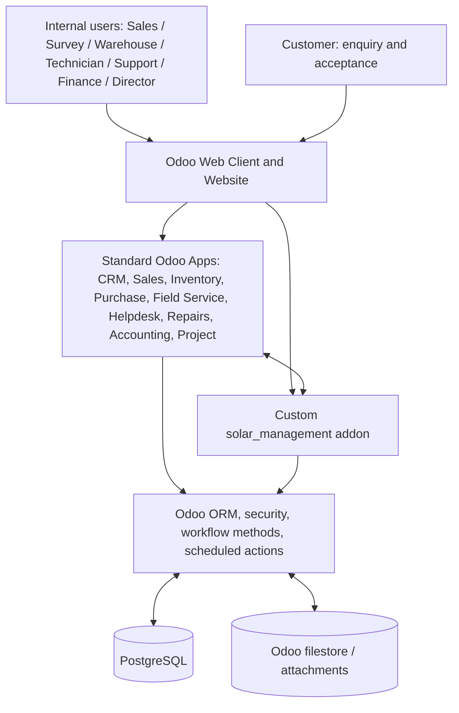
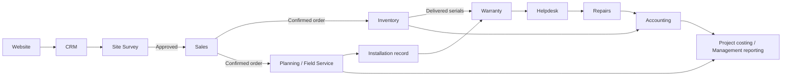

# 02 — System Architecture

**Project:** SunPower Solutions — Solar Installation Management System  
**Architecture style:** Odoo-native modular monolith with custom addon(s)  
**Status:** Proposed architecture; version and hosting must be confirmed

## 1. Architecture decision

Use Odoo as the application platform and source of business truth. Use Python and the Odoo ORM for business logic, PostgreSQL through the ORM for persistence, XML views for standard Odoo screens, and JavaScript/OWL only for interactions that cannot be delivered cleanly through standard views.

Do not introduce a separate React frontend, FastAPI backend, MongoDB database, Kafka event bus or microservice layer for the initial hackathon scope. The problem statement does not require them, and they would add integration and deployment complexity.

## 2. Logical architecture

## 3. Main layers

### 3.1 Presentation layer

- Odoo web client for internal employees.
- Odoo Website form for public enquiries if Website is available in the selected edition/environment.
- Standard Odoo form, list, kanban, calendar and pivot/graph views where appropriate.
- Mobile/tablet-friendly Field Service worksheets or custom responsive forms for technicians.
- QWeb reports for quotations, survey reports, installation completion reports and management exports where required.
- OWL/JavaScript components only for a justified interaction (for example, a specialized operational dashboard); keep the default UI Odoo-native.

### 3.2 Application/business layer

Standard Odoo applications should own their established business domains:

- CRM: leads and opportunities.
- Sales: quotations, orders and customer invoicing hand-off.
- Inventory: stock, delivery, lots/serial numbers and stock moves.
- Purchase: supplier procurement.
- Manufacturing: bills of materials/product kits if the selected setup uses this application.
- Planning/Field Service: technician schedules and field jobs, subject to edition/module availability.
- Helpdesk/Repairs: complaint tickets and repair execution, subject to edition/module availability.
- Accounting: invoices, vendor bills, payments and financial reports.
- Project/Timesheets: project/task/time-cost information where appropriate.

The custom addon owns solar-specific rules and links: survey approval gating, package metadata, installation evidence, warranty policies/records, subsidy tracking and solar-specific reporting.

### 3.3 Persistence layer

- PostgreSQL is the supported relational database for Odoo.
- Custom records are defined as Odoo models and accessed through the ORM.
- Attachments such as survey/installation photographs and signed reports use Odoo's attachment/filestore mechanism.
- Do not access or modify Odoo tables directly with ad hoc SQL for normal application operations.

### 3.4 Integration boundary

For the MVP, the main integration is between Odoo applications inside the same Odoo instance. Use model relations, Odoo methods, actions and supported ORM operations instead of inventing a parallel REST API for internal operations.

External services (WhatsApp, payment gateways, government subsidy systems, manufacturer warranty systems) are not required by the PDF. Add an integration only after an API, credentials, data contract and owner are confirmed.

## 4. Proposed custom addon boundary

Initial addon name: `solar_management`.

Responsibilities:

1. Site survey records, evidence and approval workflow.
2. Solar package metadata and package validation, while reusing product and BoM records for actual items/quantities.
3. Installation record and completion evidence.
4. Product warranty policies and serial-specific warranty records.
5. Solar service fields/rules linked to Helpdesk and Repairs.
6. Subsidy paperwork tracking.
7. Solar-specific management reports.

The addon should extend existing Odoo models only where a relationship or field is genuinely needed. Avoid duplicating standard customer, product, stock, sales, invoice or employee models.

## 5. High-level module interaction

The diagram represents intended business hand-offs, not a guarantee that every transition is automatic in standard Odoo. Each trigger must be implemented and tested.

## 6. Key architecture decisions

| Decision | Proposed choice | Rationale |
|---|---|---|
| Application platform | Odoo | The hackathon asks for an Odoo business-management solution. |
| Backend | Odoo Python models/methods/controllers as needed | Native business logic and transaction handling. |
| Database | PostgreSQL | Odoo's relational persistence layer. |
| Frontend | Odoo views, QWeb, HTML/CSS, OWL/JS selectively | Avoid a second frontend stack. |
| Customization | One domain addon initially | Easier to install, test and demonstrate. Split only if complexity/dependencies justify it. |
| Internal communication | ORM methods and model relations | Same Odoo application; no internal HTTP calls needed. |
| Files | Odoo attachments/filestore | Keep evidence connected to business records. |
| Reporting | Native reports plus custom views/reports | Share accounting source data; avoid duplicate calculations. |
| Deployment | Environment supplied by hackathon; local Docker for reproducible development if permitted | Final target is not yet known. |

## 7. Version and edition compatibility gate

Do not hard-code an Odoo version into the addon or install commands until the hackathon environment is inspected. Record:

- Odoo major version and exact build.
- Community or Enterprise edition.
- Installed modules and technical module names.
- Python version supported by that release.
- PostgreSQL version supported by that release.
- Hosting type and available shell/SSH access.
- Whether custom Python addons are permitted.

If the environment is Odoo Online, custom Python addons are generally not deployable there; confirm hosting constraints before proceeding. Odoo.sh or a self-hosted/server environment may support custom addons depending on the agreement and version.

## 8. Reliability and transaction rules

- A failed survey approval must not leave a partially generated quotation.
- Serial capture and delivery validation must be atomic according to Odoo's stock validation flow.
- Warranty records must be created idempotently: reprocessing the same delivery must not create duplicate warranty records.
- A repair ticket must reference the exact lot/serial and warranty record where available.
- Customer charges must not be created for the covered portion of an in-warranty repair.
- Use Odoo access rights and record rules for authorization; do not rely only on hiding buttons.
- Log important business transitions and preserve the user who performed them.

## 9. Observability and operations

- Use Odoo server logs for exceptions and integration diagnostics.
- Include meaningful log messages for automated transitions without logging secrets or unnecessary personal data.
- Provide a deployment checklist, module upgrade procedure and database/filestore backup procedure.
- Monitor failed scheduled actions and outbound integrations if any are added.

## 10. Open architecture decisions

See `01_PROJECT_SPEC.md` for the full decision register. The following block the final technical freeze: Odoo version, edition, hosting model, installed app availability, Field Service/Helpdesk/Repairs availability, product BoM approach and permitted custom addons.
