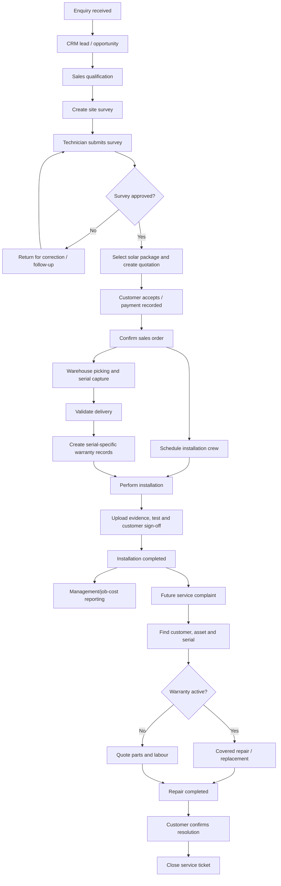

# 03 — Workflow and Navigation

**Project:** SunPower Solutions  
**Purpose:** Define end-to-end journeys, role navigation and business-state transitions before implementation.

## 1. Workflow principles

- All departments work from the same Odoo customer/order/product records.
- A workflow state is changed by an authorized action, not by arbitrary text editing.
- Each approval, delivery, installation completion and repair closure must preserve who acted and when.
- A rejected or blocked operation must explain what is missing and how to recover.
- Do not expose a quotation action until the linked survey is approved.

## 2. Proposed role journeys

### 2.1 Sales Executive

1. Open CRM pipeline.
2. Review new website/manual enquiries.
3. Assign or accept an enquiry.
4. Contact customer and record qualification details.
5. Convert qualified lead to opportunity if lead qualification is enabled.
6. Request site survey.
7. Monitor survey status.
8. Once approved, select the appropriate 1–5 kW On-Grid/Off-Grid package.
9. Generate and send quotation.
10. Confirm order after customer acceptance and required payment conditions.
11. Track order fulfilment status.

### 2.2 Survey Technician

1. Open assigned survey jobs.
2. Review customer/site details.
3. Visit customer location.
4. Record roof direction, tilt, cable distance, roof-space/shading observations and grid suitability.
5. Attach photographs and notes.
6. Submit survey for approval.
7. If rejected, review feedback and resubmit.

### 2.3 Survey Approver / Manager

1. Open submitted surveys.
2. Check required fields and evidence.
3. Approve or reject with a reason.
4. Approved survey unlocks quotation workflow.
5. Rejected survey returns to technician/sales for correction.

### 2.4 Warehouse Manager

1. Open pickings created from confirmed orders.
2. Pick package components.
3. Scan/record serials for products configured for serial tracking.
4. Resolve quantity or serial mismatches.
5. Validate delivery only when required serials are present.
6. Delivery event triggers warranty record creation for relevant serialized products.

### 2.5 Installation Technician

1. Open assigned installation job.
2. Confirm customer, site, package and dispatched equipment.
3. Record actual start time.
4. Complete installation and test system.
5. Record installed capacity and completion time.
6. Upload photographs.
7. Record successful test/power-generation confirmation.
8. Capture customer acceptance/signature.
9. Submit completion report.

### 2.6 Service Agent

1. Search customer or receive service complaint.
2. Create/open Helpdesk ticket.
3. Identify product and exact serial number.
4. Inspect the linked warranty record.
5. Assign service technician/repair.
6. If covered, mark covered repair path and prevent covered customer charges.
7. If not covered, estimate/record parts and labour and create the appropriate customer charge.
8. Record repair outcome.
9. Obtain customer confirmation.
10. Close ticket only after confirmation.

### 2.7 Accountant

1. Review customer invoices and payments.
2. Review vendor bills and purchase costs.
3. Reconcile advances and outstanding amounts.
4. Review technician costs/timesheets where configured.
5. Ensure service charges and warranty-covered work are treated correctly.
6. Support project/job cost reports.

### 2.8 Director

1. Open management dashboard.
2. Select today, this week or this month.
3. Review revenue, collections, costs and project profitability.
4. Review unfinished installations and outstanding workflow steps.
5. Review open service tickets.
6. Review subsidy paperwork and technician payments.
7. Export/share the required report.

## 3. End-to-end workflow

## 4. State definitions

### 4.1 Site survey

| State | Meaning | Allowed next state |
|---|---|---|
| Draft | Survey being prepared | Submitted |
| Submitted | Technician has provided required information | Approved, Rejected |
| Approved | Authorised approver accepted survey | Terminal for survey approval; may be superseded by a new revision if site changes |
| Rejected | Corrections/further inspection required | Draft or Submitted after correction |

Only a user in the survey approver group can approve/reject. Record approver, timestamp and rejection reason.

### 4.2 Installation

Proposed states: Draft → Scheduled → In Progress → Submitted for Review → Completed. A job may also be Cancelled. Completion requires the configured evidence fields and customer acceptance. Do not mark Completed merely because the technician opened the job.

### 4.3 Warranty

Proposed computed states: Not Started / Active / Expired / Void (only if an authorized correction/return process justifies voiding). Warranty start is derived from completed delivery date. The record should preserve the source delivery and serial/lot.

### 4.4 Service ticket

Proposed states: New → Assigned → In Progress → Waiting for Customer/Parts (optional) → Resolved Pending Confirmation → Closed. A ticket must not transition to Closed until customer confirmation is recorded. Reopen should be supported for a recurring/unresolved issue.

## 5. Navigation proposal

The final menu hierarchy depends on Odoo version and installed modules. Proposed custom menu groups:

- **Solar Operations**
  - Site Surveys
  - Installations
  - Warranty Records
  - Subsidy Cases
  - Solar Reports
- Existing Odoo menus remain the primary entry for CRM, Sales, Inventory, Field Service, Helpdesk, Repairs and Accounting.

Role-specific home actions may be configured, but do not duplicate the same record in separate custom menus unnecessarily.

## 6. Cross-role hand-offs

| From | To | Handoff | Required information |
|---|---|---|---|
| Sales | Survey technician | Survey request | Customer, address, requirements, visit details |
| Survey technician | Survey approver | Survey submission | Measurements, suitability, photos, notes |
| Survey approver | Sales | Approval result | State, approver, timestamp, reason if rejected |
| Sales | Warehouse | Confirmed order | Package lines, quantities, planned delivery |
| Sales/Operations | Planner/Technician | Installation job | Customer, site, system capacity, target date |
| Warehouse | Warranty | Completed delivery | Lot/serial, product, customer, delivery date |
| Technician | Operations/Customer | Completion evidence | Times, capacity, photos, test, signature |
| Customer support | Service technician | Repair assignment | Ticket, product, serial, warranty result |
| Service technician | Customer support | Repair result | Work performed, parts/labour, outcome |
| Departments | Director/Finance | Cost and status data | Revenue, cost, time, payment, unfinished work |

## 7. Failure and recovery cases

- Missing survey measurement: prevent submission and show the missing field.
- Survey rejected: retain the original submission and rejection reason; allow correction/resubmission.
- Quotation attempt before approval: block server-side and explain that survey approval is required.
- Package BoM missing: prevent quotation/order confirmation or clearly flag incomplete package configuration.
- Payment condition not met: prevent work-start readiness according to the configured payment policy; allow authorized override only if approved by the business.
- Missing serial number: prevent delivery validation for products configured as serial-tracked.
- Duplicate serial assignment: block duplicate assignment and identify the existing record.
- Warranty rule missing: do not silently invent duration; flag the item for policy configuration/manual review.
- Installation evidence incomplete: prevent completion submission and list missing requirements.
- Repair ticket has no exact asset/serial: retain ticket but flag asset identification as pending; do not assert warranty coverage.
- Customer does not confirm repair: keep ticket in resolved-pending-confirmation, not closed.
- Reporting data missing: show unavailable/incomplete values rather than treating them as zero without explanation.

## 8. Route and action mapping

Odoo navigation primarily uses menu items, window actions and views rather than a bespoke route table like a standalone SPA. Exact XML IDs will be added after the addon structure and installed Odoo version are confirmed. See `10_DESIGN_TO_ROUTE_MAP.md`.
