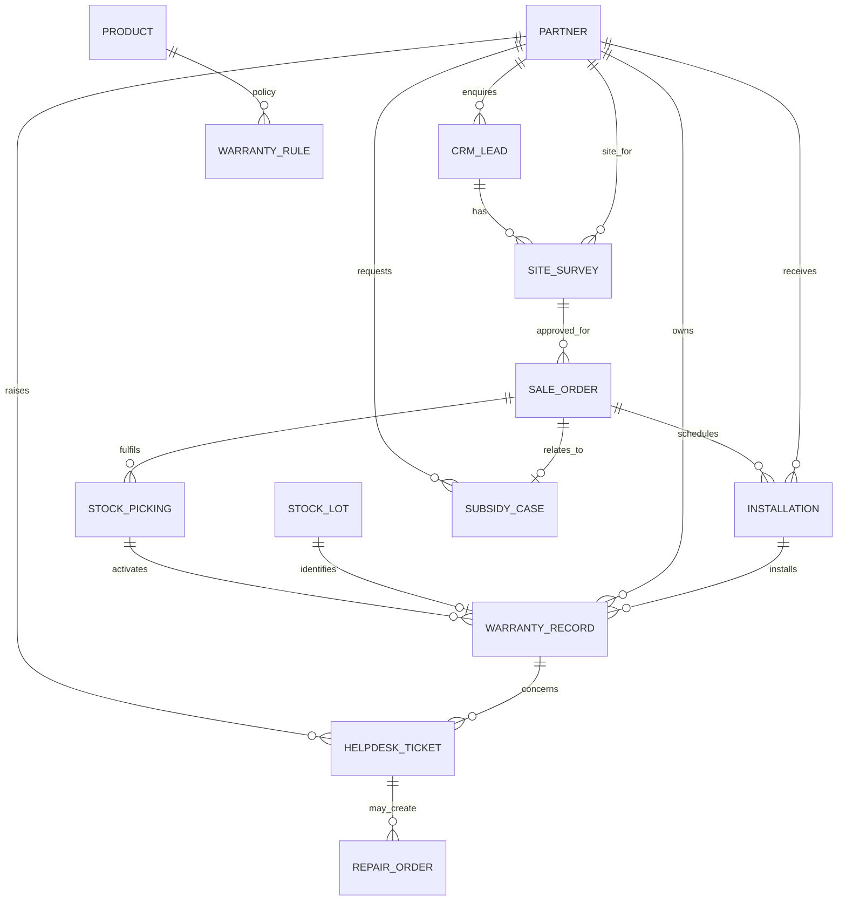

# 05 — Database Schema and Data Model

**Purpose:** Define the business entities and relationships for the solar addon while reusing Odoo's standard models.

**Important:** This is a logical schema, not a final migration script. Exact Odoo field names and model APIs must be verified against the hackathon's Odoo release before implementation.

## 1. Data modelling principles

1. Use standard Odoo models for customers, products, leads, orders, stock, vendors, invoices, employees and tickets where available.
2. Add custom models only for solar-specific information and workflow.
3. Store product serials through Odoo's lot/serial tracking mechanism, not an unrelated custom serial-number text field.
4. Keep photographs and signed documents in Odoo attachments linked to their business record.
5. Use Many2one/One2many/Many2many relations through the Odoo ORM.
6. Enforce critical rules server-side with constraints and business methods.

## 2. Logical entity relationship diagram

The standard entity labels in the diagram are conceptual and must be mapped to actual target-release Odoo models.

## 3. Standard Odoo entities to reuse

| Business entity | Odoo model family (verify version) | Use |
|---|---|---|
| Customer/company | `res.partner` | Customer identity and contact details |
| Lead/opportunity | CRM lead model, commonly `crm.lead` | Enquiry and sales qualification |
| Product/package | `product.template`, `product.product` | Solar packages and individual components |
| BoM/kit | Manufacturing/product-kit model(s) | Exact components/quantities for a package |
| Quotation/order | `sale.order`, `sale.order.line` | Commercial agreement and order lines |
| Serial/lot | `stock.lot` | Unique serialized product identity |
| Delivery | Stock picking/move/move-line models | Dispatch and completion date |
| Vendor | `res.partner` | Supplier identity |
| Purchase | Purchase order model(s) | Stock purchases |
| Invoice/payment | Accounting models | Customer billing, vendor bills and payments |
| Employee/time | Employee/timesheet model(s) | Technician and hours |
| Ticket/repair | Helpdesk/Repair model(s) if available | Complaint and repair workflow |

## 4. Custom model proposals

### 4.1 `solar.site.survey`

Purpose: Store one survey visit/revision for a customer site and proposed solar system.

| Field | Suggested type | Description |
|---|---|---|
| `name` | Char/sequence | Survey reference |
| `partner_id` | Many2one → partner | Customer |
| `lead_id` | Many2one → CRM lead | Originating enquiry (optional where survey is created from another path) |
| `sale_order_id` | Many2one → sales order | Related order, normally set after quotation/order stage |
| `site_address` | Structured address/related fields | Survey location |
| `requested_capacity_kw` | Float | Requested system capacity |
| `system_type` | Selection | On-Grid / Off-Grid |
| `monthly_bill_amount` | Monetary | Customer-provided monthly electricity bill, if captured |
| `shadow_free_roof_area` | Float + unit | Available shadow-free area; unit must be specified |
| `grid_suitability` | Selection/Boolean plus note | Grid suitability finding |
| `roof_direction` | Selection/Char | Roof direction |
| `roof_tilt` | Float + unit | Roof tilt |
| `cable_distance` | Float + unit | Cable distance |
| `technician_id` | Many2one → employee/user | Survey technician |
| `state` | Selection | Draft / Submitted / Approved / Rejected |
| `submitted_by`, `submitted_at` | User/Datetime | Submission audit |
| `approved_by`, `approved_at` | User/Datetime | Approval audit |
| `rejection_reason` | Text | Reason for rejection |
| `company_id` | Many2one → company | Multi-company readiness if needed |

Evidence photographs should be linked as attachments or an appropriate attachment relation. Avoid storing binary files as ad hoc base64 text fields unless there is a justified Odoo pattern.

### 4.2 `solar.installation`

Purpose: Track the physical installation job and evidence.

| Field | Suggested type | Description |
|---|---|---|
| `name` | Char/sequence | Installation reference |
| `partner_id` | Many2one → partner | Customer |
| `sale_order_id` | Many2one → sales order | Source order |
| `survey_id` | Many2one → site survey | Approved survey |
| `project_task_id` | Many2one → project/field task | Optional standard task linkage |
| `technician_ids` | Many2many → employees/users | Assigned crew |
| `planned_start` | Datetime | Scheduled start |
| `actual_start` | Datetime | Actual start |
| `actual_finish` | Datetime | Actual finish |
| `installed_capacity_kw` | Float | Installed system size |
| `test_result` | Selection/Text | Test outcome and notes |
| `generation_confirmed` | Boolean | Technician confirms generation test |
| `customer_signature_attachment_id` | Attachment/signature relation | Customer acceptance evidence |
| `state` | Selection | Draft / Scheduled / In Progress / Submitted / Completed / Cancelled |
| `completed_by`, `completed_at` | User/Datetime | Completion audit |

Installed serial numbers should be derived through delivery/stock lot relationships and shown on the installation. Do not create an unrelated second serial registry.

### 4.3 `solar.warranty.rule`

Purpose: Define product-specific warranty policy.

| Field | Suggested type | Description |
|---|---|---|
| `name` | Char | Policy name |
| `product_tmpl_id` or `product_id` | Many2one → product | Covered product or product template |
| `duration_value` | Integer | Warranty duration |
| `duration_unit` | Selection | Days / Months / Years |
| `start_event` | Selection | Delivery completion (required baseline) |
| `active` | Boolean | Rule enabled |
| `policy_notes` | Text | Terms/limitations |

The PDF gives example durations of 2 years for inverter/battery and 20 years for solar panels. It does not state the charge controller warranty; do not invent it.

### 4.4 `solar.warranty.record`

Purpose: Create one warranty record per delivered serialized asset/product unit.

| Field | Suggested type | Description |
|---|---|---|
| `name` | Char/sequence | Warranty reference |
| `lot_id` | Many2one → stock lot | Exact serial-numbered unit |
| `product_id` | Many2one → product | Product |
| `partner_id` | Many2one → partner | Customer receiving unit |
| `sale_order_id` | Many2one → sales order | Original order |
| `picking_id` | Many2one → stock picking | Source completed delivery |
| `installation_id` | Many2one → installation | Installed-at record, when available |
| `rule_id` | Many2one → warranty rule | Applied policy snapshot/reference |
| `warranty_start` | Date | Completed delivery date |
| `warranty_end` | Date | Computed expiry date |
| `state` | Computed selection | Active / Expired / Not Started / Void |
| `policy_snapshot` | Stored values or immutable snapshot | Preserve duration/terms applied at activation |

Use a uniqueness constraint appropriate to the business (normally one active warranty activation per serialized unit and source delivery). If a product is returned/replaced, model the replacement's new serial and warranty event explicitly.

### 4.5 `solar.subsidy.case` (proposed lightweight tracking)

Purpose: Track subsidy documentation without assuming a government API.

Suggested fields: reference, customer, sale order, scheme name, application/reference number (optional), status, document checklist/attachments, submitted date, last update, remarks, responsible user. Exact checklist and statuses must be configured after the relevant subsidy scheme is identified.

## 5. Standard model extensions

Potential extensions (only when needed):

- CRM lead: requested capacity, system type, subsidy interest, survey link/status.
- Sales order: linked approved survey, solar package identifiers and readiness flags.
- Product: system type/capacity metadata and warranty rule relation, if product variants/BoMs alone do not cover it.
- Stock lot: smart link to warranty record or computed warranty status; keep serial identity in the standard lot record.
- Helpdesk ticket: linked warranty record/lot, warranty decision, customer confirmation date and charge classification.

Do not add redundant copies of partner, product, stock or invoice fields unless a snapshot is needed for historical audit.

## 6. Relationship and integrity rules

- Survey must belong to a customer/site and carry a clear state.
- An order's approved survey must match the relevant customer and proposed system/site.
- A warranty record must reference a completed delivery and an identifiable product/serial where the product is serial-tracked.
- Warranty start date must equal the applicable delivery completion date.
- Warranty end date must be computed consistently using the stored duration/unit and a documented date-boundary rule.
- A helpdesk ticket's selected serial must belong to the ticket customer or be explicitly justified as an authorized correction.
- Duplicate warranty activation for the same serial/delivery must be blocked or safely handled idempotently.
- Evidence attachments must be linked to the correct record and accessible only to authorized users.

## 7. Data retention and audit

Preserve approval and delivery history. Avoid deleting operational records that are needed for warranty and financial audit; use cancellation/archival states according to Odoo's standard behavior. Retention periods and privacy obligations must be confirmed for the actual operating jurisdiction and hackathon deployment.

## 8. Schema decisions pending

- Exact Odoo release model/field names.
- Product variant and BoM strategy.
- Warranty terms including charge controller and accessories.
- Units for roof area, tilt and cable distance.
- Whether multiple customer sites per partner must be supported in the MVP.
- Whether subsidy tracking is one case per order or one per customer/application.
- Exact accounting analytic dimensions for per-installation costing.
