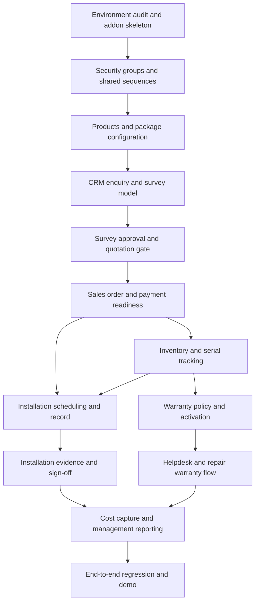

# 07 — Module Dependencies and Addon Structure

**Purpose:** Define development boundaries and the correct build order for the Odoo implementation.

## 1. Initial repository/addon structure

The exact repository layout depends on the hackathon starter project. If starting from a clean custom-addon repository, use this structure:

```text
solar-installation-management/
├── README.md
├── docs/
│   └── ... project documentation ...
├── addons/
│   └── solar_management/
│       ├── __init__.py
│       ├── __manifest__.py
│       ├── models/
│       │   ├── __init__.py
│       │   ├── site_survey.py
│       │   ├── installation.py
│       │   ├── warranty_rule.py
│       │   ├── warranty_record.py
│       │   ├── subsidy_case.py
│       │   ├── sale_order.py
│       │   ├── stock_picking.py
│       │   └── helpdesk_ticket.py
│       ├── security/
│       │   ├── groups.xml
│       │   ├── ir.model.access.csv
│       │   └── rules.xml
│       ├── views/
│       │   ├── menus.xml
│       │   ├── site_survey_views.xml
│       │   ├── installation_views.xml
│       │   ├── warranty_views.xml
│       │   ├── subsidy_views.xml
│       │   └── report_views.xml
│       ├── data/
│       │   ├── sequences.xml
│       │   └── scheduled_actions.xml
│       ├── report/
│       │   └── reports.xml
│       ├── static/
│       │   └── src/ (only if custom JS/OWL is justified)
│       └── tests/
│           ├── __init__.py
│           ├── test_survey.py
│           ├── test_warranty.py
│           ├── test_installation.py
│           └── test_service.py
└── deployment/
    └── (environment-specific files; never commit secrets)
```

This is a proposed structure. Start with only the files needed for the first milestone; do not create empty placeholder files for every feature unless the team benefits from them.

## 2. Addon dependency policy

`__manifest__.py` must declare only technical module dependencies that exist in the chosen Odoo release and are required by code in this addon. Candidate app families include Contacts, CRM, Sales, Stock, Purchase, Manufacturing, Project, Field Service, Helpdesk, Repairs, Accounting and Employees/Timesheets. Their exact technical module names and availability must be inspected before adding them to the manifest.

Avoid declaring optional apps as hard dependencies if the addon can function without them or if the hackathon edition does not include them. If Helpdesk/Repairs or Field Service is unavailable, agree and document the fallback before implementation.

## 3. Functional dependency matrix

| Custom capability | Depends on | Depends for |
|---|---|---|
| Site Survey | Contacts; CRM when linked to leads | Customer and enquiry linkage |
| Survey approval gate | Site Survey + Sales | Quote validation |
| Solar packages | Products + Sales; BoM/kit capability | Product line expansion |
| Confirmed order fulfilment | Sales + Inventory | Delivery/picking |
| Serial warranty activation | Inventory serial/lot + Warranty models | Delivery date and product identity |
| Installation record | Contacts + Sales + technician/task capability | Customer, order and crew |
| Service warranty check | Warranty + Helpdesk/Repair if installed | Ticket asset lookup and repair decision |
| Subsidy tracking | Contacts + Documents/attachments | Customer and documents |
| Profitability dashboard | Sales + Accounting + stock cost + time cost | Consistent cost/revenue measures |

## 4. Recommended implementation order



## 5. Milestone boundaries

### M0 — Environment and repository audit

Confirm Odoo release, edition, installed modules, custom-addon support, startup method, database and existing source code. No feature code before this gate.

### M1 — Addon foundation

Manifest, package imports, basic install, access groups, model sequences, menus and a smoke test.

### M2 — Product/package setup

Configure product categories, system types/capacities, individual component products, product tracking and approved package/BoM definitions. Product quantities must come from approved engineering configuration.

### M3 — CRM and site survey

Enquiry fields, survey creation, technician assignment, measurements, attachments, submission and approval/rejection.

### M4 — Sales gating and order hand-off

Quotation creation, server-side approved-survey check, package lines, customer payment recording, order confirmation and fulfilment hand-off.

### M5 — Inventory and warranty

Serial tracking, required scan/serial checks, delivery completion, idempotent warranty activation and warranty display.

### M6 — Installation

Crew assignment, mobile worksheet/form, times, capacity, photos, test and signature, completion validation.

### M7 — Service and repairs

Ticket-to-asset lookup, warranty decision, repair path, charge rules and customer confirmation closure.

### M8 — Accounting and dashboard

Revenue/cost definitions, technician time, inventory costs, open work, invoice/payment status, subsidy status, open repairs and date filters.

### M9 — Hardening and final demo

Security audit, access tests, regression, backup/reset plan, sample data and demo rehearsal.

## 6. Shared ownership rules

- Customer identity comes from Contacts; other modules reference it.
- Product identity comes from Products; inventory serial identity comes from Stock Lots/Serials.
- Sales order is the commercial order source of truth.
- Delivery is the source event for warranty start.
- Installation record references the order, customer, approved survey and delivered units.
- Helpdesk/Repair records reference the customer's exact serial/warranty record.
- Accounting remains the financial source of truth.
- No module may independently invent a duplicate status for another module's source record.

## 7. Code review and merge rules

- One branch per milestone or coherent feature.
- Do not work simultaneously on shared model definitions without agreeing field names and ownership.
- Add tests with business logic, not at the end only.
- Never commit database dumps, filestore data, API secrets, passwords or production customer data.
- Run install/upgrade and relevant tests before merging.
- Update `IMPLEMENTATION_TRACKER.md` and affected documentation when approved behavior changes.
