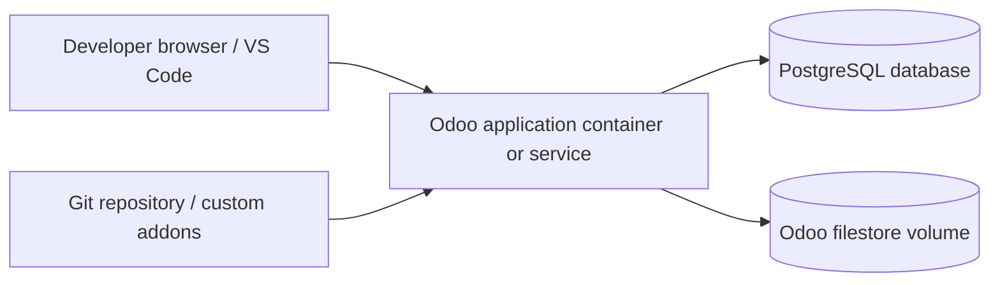

# 12 — Odoo Setup and Deployment

**Purpose:** Provide a reproducible setup process without assuming an Odoo version, edition or hosting platform that has not yet been confirmed.

## 1. Environment facts to collect first

Complete this table before implementation:

| Item | Value to record |
|---|---|
| Hackathon-provided Odoo URL/instance | Pending |
| Odoo major/minor version and build | Pending |
| Edition (Community/Enterprise) | Pending |
| Hosting (Odoo Online / Odoo.sh / self-hosted / other) | Pending |
| Custom Python addon support | Pending |
| Installed technical modules | Pending |
| Python version | Pending |
| PostgreSQL version | Pending |
| Access method (local shell/SSH/CI) | Pending |
| Addon path and config path | Pending |
| Deployment deadline/constraints | Pending |

Do not proceed with a version-specific implementation until these facts are known.

## 2. Local development option

If the hackathon allows local self-hosting, use a version-matched Odoo and PostgreSQL environment. Docker Compose is a useful reproducibility option, but the exact image tags and environment settings must match the chosen Odoo release.

Illustrative service topology:

Do not copy a generic Docker image tag from an unrelated tutorial. Choose the image and supported database/Python versions for the actual Odoo release.

## 3. Addon path and configuration

Ensure the custom addon directory is included in Odoo's `addons_path`. Keep custom addons separate from Odoo core/addons and from third-party addons. Use a development configuration that points to a disposable development database.

The following settings are environment-specific and must not be guessed:

- Odoo executable/command or container image.
- Database host, port, name and credentials.
- Addon paths.
- Master password.
- HTTP/long-polling or worker settings.
- Proxy and HTTPS configuration.
- Filestore path.

Store secrets in environment variables or the hosting platform's secret management, not in the repository.

## 4. Typical development lifecycle

1. Obtain the approved Odoo version and environment access.
2. Inspect installed apps/modules and confirm custom addon support.
3. Clone the project repository.
4. Create/configure a development database.
5. Add the custom addon directory to `addons_path`.
6. Install the minimum required standard apps.
7. Install `solar_management` in development mode.
8. Run tests for the addon.
9. Upgrade the addon after changes using the target release's supported command/UI.
10. Verify logs and test the workflow in the UI.
11. Commit source and documentation, excluding database/filestore/secrets.
12. Deploy to the hackathon-approved staging/demo environment.

Exact commands should be added only after the environment details are known.

## 5. Environment separation

| Environment | Purpose | Data policy |
|---|---|---|
| Development | Model/view implementation and unit tests | Synthetic records; disposable database |
| Staging/demo | Integrated workflow rehearsal | Seeded synthetic demo data |
| Final/hackathon | Judging demonstration | Stable, access-controlled dataset; backup before demo |

If the hackathon provides only one instance, use clearly marked demo records and take a backup before high-risk changes.

## 6. Deployment checks

- [ ] Exact Odoo version matches development.
- [ ] Required standard apps are installed.
- [ ] Custom addon manifest dependencies resolve.
- [ ] Database is backed up.
- [ ] Filestore is backed up with the database.
- [ ] No secrets are stored in Git.
- [ ] Security groups/access rights load correctly.
- [ ] Demo users can log in and see the correct menus.
- [ ] Website enquiry can be submitted.
- [ ] Critical flows pass after installation/upgrade.
- [ ] Server logs contain no unhandled errors.
- [ ] Restore procedure has been tested or at least verified.

## 7. Odoo Online / Odoo.sh / self-hosted decision

- **Odoo Online:** confirm limitations before planning custom Python addons; do not assume arbitrary server-side addons can be installed.
- **Odoo.sh:** confirm subscription, supported version, repository and branch workflow, staging/build access and addon deployment instructions.
- **Self-hosted/server provided by organizers:** confirm SSH/shell access, addon path, database rights, backup responsibility and deployment window.

The actual hosting target must be supplied/confirmed by the team or organizers.

## 8. Backup and recovery

A reliable backup includes both the PostgreSQL database and the corresponding Odoo filestore. Backing up only one may leave attachments such as survey and installation photographs unavailable. Define backup timing, retention and restore owner for the final environment.

## 9. Update procedure

- Pull the approved branch/commit.
- Back up database and filestore.
- Update the custom addon using the correct target-release procedure.
- Review logs.
- Run smoke tests and the critical scenario regression suite.
- Confirm user permissions and attachments.
- Record deployed commit and verification result in `IMPLEMENTATION_TRACKER.md`.
