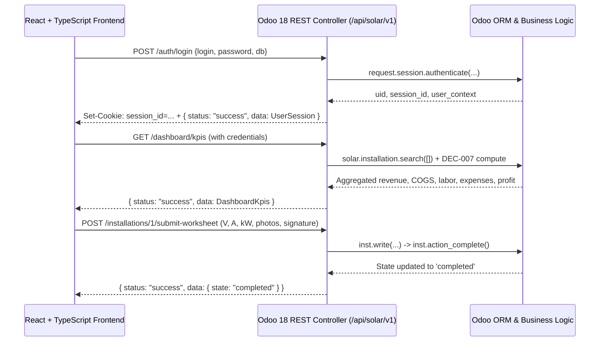

# 17. React + TypeScript API Integration Guide

**System:** SunPower Solutions — Solar Installation Management System  
**Backend:** Odoo 18.0 Community Edition (REST/JSON API)  
**Frontend Stack:** React 18+ / TypeScript / Vite / Tailwind CSS  
**Base Route:** `/api/solar/v1`  
**Authentication Scheme:** Cookie Session (`session_id`) with CORS Credentials  

---

## 1. Architecture Overview

The Odoo backend exposes a dedicated, secure REST/JSON controller layer ([`addons/solar_management/controllers/api.py`](file:///d:/Desktop/Hackathon/Final%20Round/addons/solar_management/controllers/api.py)) tailored for decoupled single-page applications (SPAs):



---

## 2. CORS & Client Configuration

### 2.1 Allowed Origins
The backend strictly enforces the following allowed origins (no wildcard `*` for authenticated requests):
- `http://localhost:5173` (Vite dev server default)
- `http://localhost:3000` (Create React App default)
- `http://127.0.0.1:5173` / `http://127.0.0.1:3000`
- `https://solar-installation-management-system.odoo.com`

### 2.2 Axios / Fetch Configuration
Always ensure `credentials: 'include'` (Fetch) or `withCredentials: true` (Axios) so session cookies are transmitted across origins:

```typescript
// src/api/client.ts
import axios from 'axios';

export const apiClient = axios.create({
  baseURL: import.meta.env.VITE_API_URL || 'http://localhost:8069/api/solar/v1',
  withCredentials: true, // CRITICAL: sends and receives session_id cookie
  headers: {
    'Content-Type': 'application/json',
    'Accept': 'application/json',
  },
});
```

---

## 3. Standard JSON Response Envelope

All API endpoints return a predictable JSON envelope:

```typescript
export interface ApiResponse<T> {
  status: 'success' | 'error';
  code: number;
  message: string | null;
  data: T;
  error?: string;
}
```

### Success Example (HTTP 200)
```json
{
  "status": "success",
  "code": 200,
  "message": "Site survey approved successfully.",
  "data": {
    "id": 1,
    "state": "approved"
  }
}
```

### Error Example (HTTP 400 / 403 / 404)
```json
{
  "status": "error",
  "code": 403,
  "message": "Permission denied. Required role: solar_management.group_solar_survey_manager",
  "data": {},
  "error": "FORBIDDEN"
}
```

---

## 4. Primary Endpoint Quick Reference

| Method | Endpoint | Description | Required Role / Permission |
| :--- | :--- | :--- | :--- |
| `POST` | `/auth/login` | Authenticate and create session | None (Public) |
| `GET` | `/auth/session` | Check session state and permissions | Authenticated User |
| `POST` | `/auth/logout` | Terminate session | Authenticated User |
| `GET` | `/dashboard/kpis` | Executive KPI aggregates (Scenario 6) | Solar User |
| `GET` | `/crm/leads` | List solar CRM enquiry opportunities | Sales Executive |
| `POST` | `/crm/leads` | Create new rooftop enquiry lead | Sales Executive |
| `POST` | `/crm/leads/{id}/create-survey` | Generate site survey from lead | Sales Executive |
| `GET` | `/surveys` | List technical rooftop surveys | Survey Technician / Manager |
| `POST` | `/surveys/{id}/approve` | Approve survey (Quotation Gate) | **Survey Manager** |
| `POST` | `/surveys/{id}/create-quotation` | Generate quotation from survey | Sales Executive |
| `GET` | `/packages` | List 1-5 kW packages with BoM kits | Solar User |
| `GET` | `/orders` | List sales orders & advance status | Sales Executive |
| `POST` | `/orders/{id}/record-advance` | Record 20% advance payment (Gate) | Sales Executive |
| `POST` | `/orders/{id}/confirm` | Confirm order (Checks survey & advance) | Sales Executive |
| `GET` | `/inventory/dispatches` | Outbound equipment dispatches | Warehouse Operator |
| `POST` | `/inventory/dispatches/{id}/scan` | Barcode serial scan validation | Warehouse Operator |
| `GET` | `/serials/lookup/{serial_no}` | Instant serial warranty lookup | Solar User |
| `GET` | `/installations` | List assigned mobile installations | Installation Technician |
| `POST` | `/installations/{id}/submit-worksheet` | Submit tests, photos & touch signature | Installation Technician |
| `GET` | `/service/tickets` | List breakdown tickets & claims | Service Agent |
| `POST` | `/service/tickets/{id}/create-repair` | Generate ₹0 or chargeable repair | Service Agent |
| `GET` | `/subsidies` | PM Surya Ghar CFA tracking cases | Solar User |

---

## 5. TypeScript Types
All data interfaces are located in [`docs/solar-api.types.ts`](file:///d:/Desktop/Hackathon/Final%20Round/docs/solar-api.types.ts).
Copy this file into your React project:
```bash
cp docs/solar-api.types.ts frontend/src/types/solar-api.ts
```
