# SunPower Solutions — Hackathon Final Live Demonstration Script
## End-to-End Rooftop Solar Lifecycle (Scenarios 1 to 6)

> **Document Type:** Presenter Walkthrough Guide & Evaluation Defense
> **Target Audience:** Hackathon Judges, Technical Evaluators, and Senior Leadership
> **Estimated Presentation Time:** 10 – 15 Minutes
> **System Baseline:** Odoo 18.0 Community Edition (CE)

---

## 1. Pre-Flight Checklist & Demo Preparation

Before launching the presentation, ensure the environment is clean and ready:

1. **Service Status:**
   - PostgreSQL 16 (or port 5000 host fallback) is running.
   - Odoo 18.0 container / service is active on `http://localhost:8069`.
2. **Browser Profiles:**
   - Prepare clean tabs / incognito windows for role-switching without revealing credentials:
     - **Tab 1:** Public Website Enquiry Form (`/solar/enquiry`)
     - **Tab 2:** Operational User / Technician / Sales
     - **Tab 3:** Director / Management Dashboard
3. **Automated Verification Pre-Check:**
   - Run `python scripts/run_full_cycle_verification.py` to confirm all 9 scenario contracts pass with 100%.

---

## 2. Live Demonstration Script — Scene by Scene

```mermaid
sequenceDiagram
    autonumber
    actor Customer as Arun Kumar (Customer)
    actor Sales as Sales & Survey Team
    actor Ops as Warehouse & Installation Crew
    actor Service as Support & Repair Agent
    actor Director as Executive Director

    Customer->>Sales: 1. Submits 3 kW Rooftop Enquiry (/solar/enquiry)
    Sales->>Sales: 2. Completes Site Survey (35 m², 15° tilt, South)
    Note over Sales: Survey Approval Gate: Quotation blocked until approved
    Sales->>Customer: 3. Quotes 3 kW Kit (₹1,89,000)
    Note over Sales: Advance Gate: Order blocked until 20% (₹37,800) paid
    Customer->>Sales: 4. Pays ₹37,800 Advance -> Order Confirmed
    Sales->>Ops: 5. Auto-generates Dispatch, Installation Job & Subsidy Case
    Note over Ops: Serial Gate: Dispatch blocked until serial scanned
    Ops->>Ops: 6. Scans Inverter INV-AK-3KW-9901 -> Dispatched
    Note over Ops: Auto-activates 24-month Warranty on Delivery Date
    Ops->>Customer: 7. Mounts panels, runs 2.85 kW Power Test, gets Signature
    Note over Ops: Commissioning Gate: Photos + Test + Signature required
    Customer->>Service: 8. 18 Months later: Reports Error E04 Inverter Fault
    Service->>Service: 9. Verifies Active Warranty (< 24m) -> ₹0 Repair Order
    Note over Service: Closure Gate: Ticket blocked until customer confirms resolution
    Customer->>Service: 10. Confirms Rooftop Grid Synchronization -> Ticket Closed
    Director->>Director: 11. Opens Director Dashboard: DEC-007 Contrib Profit ₹49,250 (26.06%)
```



---

### Scene 1: Customer Enquiry, Qualification & Mandatory Survey Approval Gate
*Target Requirements: SOL-CRM-01 to SOL-SUR-03 | Evaluates Scenario 1*

#### Presenter Action:
1. Open browser to `http://localhost:8069/solar/enquiry`.
2. Fill out Arun Kumar's details:
   - **Full Name:** `Arun Kumar`
   - **Phone:** `+91 98480 22334` | **City:** `Hyderabad`
   - **Requested Capacity:** `3 kW` | **System Type:** `On-Grid (Grid-Tied)`
   - **Average Monthly Electricity Bill:** `₹4,500` | **Roof Area:** `380 sq ft`
   - **Interested in Government Subsidy:** `Checked`
3. Click **"Submit Solar Enquiry"**.

#### What to Show & Talk Track:
> *"Notice how the customer's rooftop interest instantly flows into Odoo CRM. The system calculates estimated generation and immediately qualifies Arun Kumar."*
- Switch to Odoo Backend $\to$ **Solar Operations $\to$ CRM Leads / Pipeline**.
- Open **"Arun Kumar — 3 kW On-Grid Rooftop Solar Enquiry"**.
- Click **"Rooftop Site Survey"** smart button.
- Point out technical parameters recorded:
  - Roof area: $35\text{ m}^2$ (shadow-free), Tilt: $15^\circ$, Direction: South.
  - Shading Analysis: Clear / No Obstructions, Grid Suitability: Suitable.
- **Mandatory Approval Gate Demo:**
  - Attempt to issue/confirm a quotation while the survey is in `draft` or `submitted` status. Show that quotation generation/confirmation is **strictly blocked** by the system.
  - Click **"Approve Site Survey"** (as Survey Manager). Status transitions to **Approved** with audit timestamp.

---

### Scene 2: Package Quotation, BoM Explosion & Advance Payment Check
*Target Requirements: SOL-SALE-01 to SOL-OPS-02 | Evaluates Scenario 2*

#### Presenter Action:
1. Navigate to **Solar Operations $\to$ Quotations & Orders**.
2. Open Arun Kumar's Quotation (`SO/2026/00001` or create from approved survey).
3. Select **Package**: `3 kW On-Grid System`.

#### What to Show & Talk Track:
> *"By selecting a pre-engineered package, Odoo automatically explodes the Bill of Materials (BoM kit) into the quotation: 6x 540W Mono PERC Panels, 3kW Inverter, Mounting Stands, AC/DC Box, and Earthing accessories."*
- Show Sales Price: **₹1,89,000**.
- Point out the **Advance Payment Policy**: Set to 20% Standard.
- System automatically calculates **Required Advance: ₹37,800.00**. Status displays **"Advance Pending"**.
- **Advance Payment Gate Demo:**
  - Click **"Confirm Order"**. The system throws a validation alert:
    *`"Cannot confirm Solar Order: Customer advance payment of ₹37,800.00 is required. Current status: Advance Pending."`*
  - Click **"Record Advance Payment"** (Simulating customer bank transfer reference `NEFT-HDFC-998822`).
  - Status updates to **"Advance Paid / Cleared"** and **Work-Ready** badge activates!
  - Click **"Confirm Order"**.
- **Show Automated Operations Handoff:**
  - Show Chatter log: Warehouse picking generated, Solar Installation Job created, and Government Subsidy Case created automatically!

---

### Scene 3: Serial Scanning Dispatch & Automatic Warranty Activation
*Target Requirements: SOL-STK-01 to SOL-WAR-02 | Evaluates Scenario 3*

#### Presenter Action:
1. Open the linked **Delivery Picking** from the sales order or go to **Inventory $\to$ Operations $\to$ Transfers**.
2. Open picking for Arun Kumar.

#### What to Show & Talk Track:
> *"Scenario 3 mandates that critical solar equipment—inverters, batteries, and charge controllers—must be serialized before leaving the warehouse."*
- **Serial Scanning Gate Demo:**
  - Click **"Validate"** without entering a serial number.
  - The system blocks dispatch:
    *`"Dispatch Validation Blocked: Product 'SunPower Inverter 3 kW' is Serial-Tracked. You must scan/enter unique serial numbers before completing dispatch."`*
  - Demonstrate duplicate serial prevention: Attempting to scan the same serial number twice in the same transfer raises a duplicate validation error.
- Use the **Community Barcode Scan Helper**:
  - Scan / enter: `INV-AK-3KW-9901`.
  - The move line automatically links the serial number.
- Click **"Validate"**. Picking transitions to **Done**.
- **Automated Warranty Clock Activation:**
  - Navigate to **Solar Operations $\to$ Warranty Records**.
  - Show certificate `WAR/2026/00001` automatically created for serial `INV-AK-3KW-9901`.
  - Point out that **Warranty Start Date** is set exactly to the **Delivery Date**, with duration calculated as **24 months** (Policy DEC-004), valid until October 2028!

---

### Scene 4: Mobile Installation Worksheet & Commissioning Gate
*Target Requirements: SOL-INST-01 to SOL-INST-06 | Evaluates Scenario 4*

#### Presenter Action:
1. Navigate to **Solar Operations $\to$ Installations**.
2. Open Arun Kumar's Job (`INST/2026/00001`).

#### What to Show & Talk Track:
> *"Technicians on customer rooftops use this mobile worksheet to record real-time progress, power generation measurements, photo proof, and digital customer acceptance."*
- Click **"Start Work (On Roof)"**: Actual Work Start timestamp is recorded.
- Crew: Lead Technician assigned + Crew members.
- Actual Duration computed automatically: **7.5 Hours**.
- Fill Technical Measurements:
  - **Measured DC String Voltage:** `380.0 V`
  - **Measured AC Grid Voltage:** `232.0 V`
  - **Peak Test Generation:** `2.85 kW` (under clear midday sunlight)
- **Mandatory Commissioning Evidence Gate Demo:**
  - Click **"Commission & Complete"** without attaching photos or customer signature.
  - System blocks completion:
    *`"Installation Completion Blocked: At least one installation photo and customer signature are required."`*
- Attach Proof:
  - Rooftop Array Photo attached.
  - Inverter & AC/DC Box Photo attached.
  - Power Generation Test Confirmed toggle $\to$ `True`.
  - Customer Digital Signature: Draw on-screen signature widget $\to$ Signed by `Arun Kumar`.
- Click **"Commission & Complete"**. Job transitions to **Completed & Commissioned** with green ribbon!

---

### Scene 5: 18-Month Breakdown, Warranty Lookup & ₹0 Repair
*Target Requirements: SOL-SRV-01 to SOL-SRV-05 | Evaluates Scenario 5*

#### Presenter Action:
1. Navigate to **Solar Operations $\to$ Service Tickets**.
2. Open prepared 18-month breakdown claim for Arun Kumar:
   - **Customer:** Arun Kumar
   - **Serial Number:** `INV-AK-3KW-9901`
   - **Claim Date:** 18 Months post-delivery (Simulated timeline per Scene 5 specification).
   - **Fault Category:** Inverter Failure (Error Code E04 Grid Overvoltage).

#### What to Show & Talk Track:
> *"18 months after installation, the customer calls support reporting an inverter fault. The agent immediately pulls up Arun Kumar and enters the inverter serial."*
- Show that Odoo performs an instant warranty lookup:
  - Inverter warranty is active for 24 months ($18 < 24$ months).
  - Status displays **"Under Warranty (₹0 Customer Charge)"**.
- Click **"Create Repair Order"**:
  - Show the linked Repair Order (`RO/2026/00001`).
  - Warranty billing policy automatically sets **Parts to ₹0** and **Labor to ₹0** with customer total **₹0.00**!
  - Contrast with an out-of-warranty case where parts and technician labor are billed.
- **Mandatory Customer Confirmation Closure Gate Demo:**
  - Technician marks the ticket **Resolved**.
  - Attempt to click **"Close Ticket"**. The system blocks closure:
    *`"Closure Blocked: Service ticket cannot be closed until the customer has explicitly confirmed successful resolution."`*
  - Check **"Customer Confirmed Resolution"** (via OTP / Confirmation Call).
  - Click **"Close Ticket"**. Status transitions to **Closed**.

---

### Scene 6: Director Overview, DEC-007 Profitability & Subsidy Tracking
*Target Requirements: SOL-MGT-01 to SOL-MGT-06 | Evaluates Scenario 6*

#### Presenter Action:
1. Navigate to **Solar Operations $\to$ Finance & Costing $\to$ Installation Profitability**.
2. Open Arun Kumar's Job and switch to the **"Project Costing & Profitability (DEC-007)"** tab.

#### What to Show & Talk Track:
> *"Here is the executive view resolving DEC-007. We do not just look at sales price minus hardware cost. We report true Installation Contribution Profit by accounting for actual technician labor and direct project disbursements."*

- **The Financial Breakdown on Screen:**
  1. **Invoiced Revenue:** ₹1,89,000.00
  2. **Material COGS (Delivered Hardware):** ₹1,26,000.00
     - $\implies$ **Tier 1 Gross Margin:** **₹63,000.00 (33.33%)**
  3. **Operational Labor Cost:** ₹3,750.00 ($7.5\text{ hours} \times \text{₹500/hr} \times 1\text{ technician}$)
  4. **Attributable Direct Expenses (Vendor Bills):**
     - Flatbed Transport & Freight: ₹3,500.00
     - CEIG Electrical Safety Inspection: ₹2,500.00
     - DISCOM Net-Metering Permit Application: ₹4,000.00
     - $\implies$ **Total Direct Expenses:** **₹10,000.00**
  5. **Total Direct Installation Cost:** ₹1,39,750.00
  6. **Tier 2 Installation Contribution Profit (DEC-007):**
     $$\text{Contribution Profit} = \text{₹1,89,000} - \text{₹1,39,750} = \mathbf{₹49,250.00}$$
     $$\text{Contribution Margin} = \mathbf{26.06\%} \quad (\textbf{Status: Healthy > 20\%})$$

- **Show Multidimensional Reporting & Director Overview:**
  - Navigate to **Solar Operations $\to$ Reporting $\to$ Installation Profitability**.
  - Show the **Pivot Table**: Group by Lead Technician, Profitability Status, and Month.
  - Show one-click Excel download capability (`SOL-MGT-06`).
  - Navigate to **Reporting $\to$ Subsidy Pipeline (DBT)**:
    - Show Arun Kumar's PM Surya Ghar CFA central subsidy: **₹78,000.00**.
    - Show statutory checklist: all 6 mandatory documents (Aadhaar, Electricity Bill, Rooftop Ownership, Bank Passbook, Commissioning Cert, Net-Meter Report) verified.

---

## 3. Evaluator Defense & Key Architecture Decisions (DEC-001 to DEC-009)

When evaluators ask technical or architectural questions, reference these exact decisions:

| Decision ID | Question / Challenge | Approved Solution & Defense |
| :--- | :--- | :--- |
| **DEC-001** | *Why Odoo 18.0 Community Edition?* | 100% open-source baseline without Enterprise license dependency, fulfilling all competition constraints. |
| **DEC-002** | *How are 1–5 kW packages managed?* | Pre-engineered `solar.package` models linked to Phantom Kit BoMs (`mrp.bom`), automating component explosion upon quotation line creation. |
| **DEC-003** | *Why gate quotation on survey approval?* | Rooftop solar feasibility, structural shadow analysis, and sanctioned load cannot be assumed. Gating prevents unfulfillable contracts. |
| **DEC-004** | *How are warranties tracked?* | Warranty certificates (`solar.warranty.record`) activate on delivery picking validation date, linking directly to equipment serials (`stock.lot`). |
| **DEC-005** | *How is the 18-month breakdown handled?* | Real-time date diff against 24-month policy validates covered repair. System enforces ₹0 parts/labor and blocks ticket closure without customer sign-off. |
| **DEC-007** | *How is profit calculated?* | Formally distinguishes **Gross Margin** from **Installation Contribution Profit** ($\text{Revenue} - \text{COGS} - \text{Labor} - \text{Attributable Direct Expenses}$ like freight/permits). Overhead net profit is cleanly separated. |
| **DEC-009** | *How is customer acceptance captured?* | Digital on-screen signature widget embedded directly into the mobile installation worksheet alongside generation test evidence. |

---

## 4. Reset Strategy During Live Rehearsal

If a presenter wants to re-run the presentation from scratch:
```powershell
# Execute the automated verification runner to verify database consistency
python scripts/run_full_cycle_verification.py

# Verify security permissions
python scripts/audit_security_matrix.py
```
All synthetic demo records (`partner_arun_kumar`, `package_3kw_on_grid`, `survey_arun_kumar_approved`, `sale_order_arun_kumar_3kw`, `installation_arun_kumar_3kw`, `warranty_arun_kumar_inverter`, `ticket_arun_kumar_inverter_e04`, `invoice_arun_kumar_3kw`, `subsidy_case_arun_kumar_3kw`) are cleanly persisted in `addons/solar_management/data/` and can be reloaded at any time.

